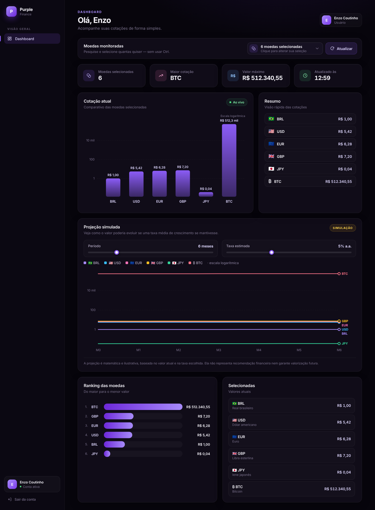

# Dashboard de Moedas e Projeções

**[Ver demo ao vivo](https://enzocoutinh0.github.io/Dashboard/)** · Entre como visitante ou crie uma conta de teste.



> A demo no GitHub Pages é uma versão estática: como o Pages não executa PHP nem MySQL, o login é simulado no navegador (os dados ficam só no `localStorage` de quem usa, e a senha é salva como hash SHA-256). A versão completa, com PHP + MySQL, está na pasta `Dashboard/`.

## Sobre o projeto

Este projeto consiste em uma dashboard web para acompanhamento e comparação de moedas, com sistema de autenticação de usuários, seleção personalizada de moedas, consulta de cotações e gráficos de evolução/projeção.

A aplicação foi desenvolvida com foco em uma interface moderna, simples de utilizar e com atualização dinâmica das informações.

## Principais funcionalidades

### Sistema de login e cadastro

A aplicação possui um sistema completo de autenticação:

- Tela de login.
- Cadastro de novos usuários.
- Campos para nome, e-mail, telefone e senha.
- Senhas armazenadas de forma segura utilizando hash.
- Controle de sessão para proteger o dashboard.
- Logout.
- Banco de dados MySQL para armazenamento dos usuários.

### Dashboard

Após realizar o login, o usuário tem acesso ao painel principal, onde pode:

- Visualizar informações das moedas selecionadas.
- Comparar diferentes moedas simultaneamente.
- Alterar a quantidade de meses analisados.
- Visualizar gráficos de evolução.
- Trabalhar com diferentes cenários de crescimento.
- Atualizar as cotações sem precisar recarregar toda a página.

## Seleção de moedas

Foi criado um seletor de moedas pensado para facilitar a comparação.

O usuário pode:

- Pesquisar uma moeda.
- Selecionar várias moedas.
- Remover moedas individualmente.
- Visualizar as moedas atualmente selecionadas.
- Alterar a seleção sem precisar utilizar a tecla `Ctrl`.
- Selecionar moedas de forma rápida através da interface visual.

A seleção é controlada pelo JavaScript para evitar moedas duplicadas.

A moeda BRL possui tratamento especial por ser a moeda base da aplicação:

- BRL = 1
- As demais moedas são comparadas em relação ao real.

## Cotações

A dashboard utiliza dados de cotação para alimentar as comparações.

O sistema foi estruturado para:

- Carregar o catálogo de moedas.
- Reutilizar dados já carregados quando possível.
- Evitar consultas desnecessárias.
- Atualizar as informações de forma dinâmica.
- Tratar falhas ou demora da API.
- Evitar múltiplas atualizações simultâneas.

Bitcoin também possui tratamento separado para permitir sua utilização na comparação.

## Gráficos

A dashboard apresenta gráficos para facilitar a interpretação dos dados.

O usuário pode alterar:

- Período em meses.
- Taxa/cenário estimado de crescimento.
- Moedas utilizadas na comparação.

Os gráficos são atualizados dinamicamente sem necessidade de recarregar a página inteira.

### Projeção

Além da cotação atual, a aplicação possui uma simulação de crescimento ao longo dos meses.

Essa projeção é uma **simulação**, não uma previsão financeira ou garantia de rendimento.

Ela serve para demonstrar visualmente como diferentes taxas de crescimento poderiam afetar os valores ao longo do tempo.

## Otimização e correções

Durante o desenvolvimento foram identificados e corrigidos problemas de desempenho e comportamento da interface.

Entre as melhorias realizadas:

- Redução de atualizações desnecessárias do DOM.
- Evitação de listeners duplicados.
- Centralização do estado do dashboard.
- Prevenção de chamadas simultâneas às APIs.
- Timeout para requisições externas.
- Reutilização de dados já carregados.
- Atualização mais rápida dos gráficos.
- Otimização do evento de redimensionamento da janela.
- Prevenção de moedas duplicadas.
- Correção do comportamento do seletor de moedas.
- Remoção de código redundante e funções sem utilização.
- Validação da sintaxe dos arquivos PHP e JavaScript.

O objetivo dessas melhorias foi deixar a aplicação mais rápida, estável e preparada para futuras funcionalidades.

## Tecnologias utilizadas

### Front-end

- HTML5
- CSS3
- JavaScript
- Interface responsiva
- Manipulação dinâmica do DOM
- Gráficos e componentes interativos

### Back-end

- PHP
- Sessões PHP
- PDO
- MySQL

### Ambiente

O projeto pode ser executado localmente utilizando:

- XAMPP
- Apache
- MySQL
- phpMyAdmin

## Estrutura principal

```text
├── Dashboard/            # aplicação completa (PHP + MySQL)
│   ├── index.php         # login
│   ├── cadastro.php
│   ├── registrar.php
│   ├── autenticar.php
│   ├── dashboard.php
│   ├── logout.php
│   ├── config.php
│   ├── database.sql
│   └── assets/
│       ├── auth.css
│       ├── auth.js
│       ├── dashboard.css
│       └── dashboard.js
│
└── docs/                 # demo estática publicada no GitHub Pages
    ├── index.html
    ├── cadastro.html
    ├── dashboard.html
    └── assets/demo.js    # login simulado no navegador
```

## Banco de dados

O projeto utiliza MySQL para armazenar os usuários cadastrados.

A estrutura pode ser criada através do arquivo:

```text
database.sql
```

O acesso ao banco é configurado no arquivo:

```text
config.php
```

As senhas dos usuários não são armazenadas em texto puro. O sistema utiliza mecanismos de hash para armazená-las de forma mais segura.

## Como executar

1. Instale o XAMPP.
2. Inicie os serviços **Apache** e **MySQL**.
3. Coloque a pasta do projeto dentro de:

```text
C:\xampp\htdocs\
```

4. Crie o banco de dados utilizando o arquivo `database.sql`.
5. Confira as configurações de conexão em `config.php`. Por padrão ele usa o usuário `root` sem senha do XAMPP; em outro ambiente, defina as variáveis `DB_HOST`, `DB_NAME`, `DB_USER` e `DB_PASS`.
6. Abra no navegador:

```text
http://localhost/Dashboard/
```

## Objetivo do projeto

O objetivo principal foi desenvolver uma dashboard que unisse:

- Autenticação de usuários.
- Banco de dados.
- Consulta de moedas.
- Comparação de valores.
- Gráficos interativos.
- Simulações de crescimento.
- Interface moderna.
- Atualização dinâmica.
- Boa experiência de utilização.

O projeto também foi estruturado pensando em manutenção e evolução, permitindo que novas moedas, indicadores, gráficos e funcionalidades sejam adicionados futuramente.

## Observação

Os valores de projeção apresentados pela dashboard são exclusivamente simulativos. Eles não representam recomendação de investimento, previsão garantida de mercado ou promessa de rentabilidade.
